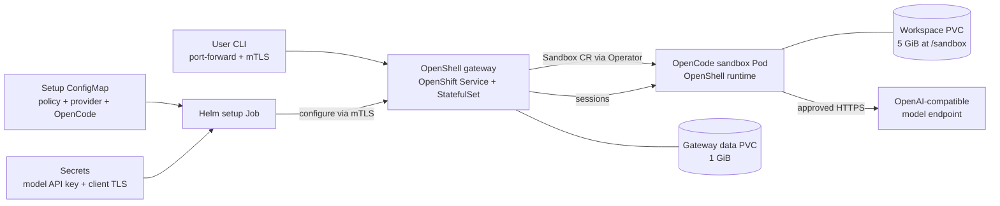

# OpenShell + OpenCode on OpenShift

## Executive summary

Run OpenCode inside an OpenShell-managed sandbox on OpenShift using your own OpenAI-compatible model endpoint. Helm handles installation and an automated setup Job configures the model, creates the sandbox, and checks that it works.

Uses ordinary container Pods and a persistent workspace. No Kata or MicroVM is required.

| Component | Version |
| --- | --- |
| OpenShell | 0.1.9 |
| OpenCode | `ghcr.io/anomalyco/opencode:1.19.6` or custom built image |
| Setup helper | Devfile UBI 9 base developer image, digest-pinned |
| Red Hat build of Agent Sandbox Operator | `preview-0.9` channel, automatic updates |

## Architecture



The setup Job runs after Helm installation and upgrades. It registers the model provider, creates the sandbox through the Agent Sandbox Operator, and applies its policies. The user connects through a local port-forward; no public Route is created. OpenShell substitutes the API key for approved requests, while the OpenCode configuration in `/sandbox` refers only to a placeholder. [values.yaml](charts/openshell-opencode/values.yaml) also configures a GitHub egress rule; other outbound destinations need their own policy entries.

## 1. Prerequisites

Use an OpenShift admin login with `oc`, Helm 3, and the [OpenShell 0.1.9 CLI](https://github.com/NVIDIA/OpenShell/releases/tag/v0.1.9).

Replace the dummy API key in [model-credentials-secret.yaml](prerequisites/model-credentials-secret.yaml), then apply all prerequisites:

```sh
oc apply -f ./prerequisites/openshell-opencode-namespace.yaml -f ./prerequisites/
```

This creates the namespace, Secret, and Agent Sandbox Operator subscription. Never commit your real key. Wait for the Operator to show **Succeeded** in **Operators → Installed Operators** before continuing.

Requires persistent block storage, NetworkPolicy enforcement, and the `redhat-operators` catalog with channel `preview-0.9`. If Agent Sandbox is already installed, omit [agent-sandbox-operator.yaml](prerequisites/agent-sandbox-operator.yaml) from the apply.

## 2. Configure your model

Edit [values.yaml](charts/openshell-opencode/values.yaml):

```yaml
model:
  baseURL: https://your-model.example.com/v1
  id: your-model-id
  secretName: model-credentials
  secretKey: api-key
```

Include the API base path, usually `/v1`, in `baseURL`.

<details>
<summary>Optional: private endpoints, storage, and extra network access</summary>

- **Private IP:** Set `model.allowedIPs` to the endpoint's IP or required CIDR.
- **Private CA:** Create a ConfigMap containing `ca.crt` in the project. Set `openshell.supervisor.network.additionalCaConfigMapName` to its name.
- **Storage:** Defaults are 1 GiB for the gateway and 5 GiB for the workspace. Set `openshell.server.dataStorageClass` and `openshell.server.workspaceStorageClass` before installing if needed. Existing PVCs are not resized automatically.
- **Static policies:** Configure `sandbox.filesystemPolicy`, `sandbox.landlock`, `sandbox.process`, and `sandbox.networkMiddlewares` using OpenShell policy field names within each block. Changes require explicit sandbox recreation. Empty process settings retain the runtime-assigned identity.
- **Other destinations:** Only your model endpoint is allowed initially. Add complete policy entries under `sandbox.networkPolicies`. Rerun the Helm command to reconcile changes on the existing sandbox.

</details>

## 3. Build a custom OpenCode image (optional)

The [Containerfile](Containerfile) copies OpenCode and its runtime into UBI 10 and installs Git, curl, wget, and skopeo. To use this image, build and push it from this repository to a registry your OpenShift cluster can pull from:

```sh
podman build -f Containerfile -t quay.io/YOUR_ORG/opencode:ubi10-latest .
podman push quay.io/YOUR_ORG/opencode:ubi10-latest
```

Set `sandbox.image` in [values.yaml](charts/openshell-opencode/values.yaml) to that same image reference:

```yaml
sandbox:
  image: quay.io/YOUR_ORG/opencode:ubi10-latest
```

If you skipped the optional build, set `sandbox.image` in [values.yaml](charts/openshell-opencode/values.yaml) to the upstream OpenCode image:

```yaml
sandbox:
  image: ghcr.io/anomalyco/opencode:1.19.6
```

The current [values.yaml](charts/openshell-opencode/values.yaml) selects `docker.io/moosestack/opencode:ubi10-latest`; replace that reference with your chosen image. Ensure the selected image is accessible to the cluster before installing.

## 4. Install OpenShell and OpenCode

Run from this repository:

```sh
helm upgrade --install openshell-opencode ./charts/openshell-opencode \
  --reset-values -f ./charts/openshell-opencode/values.yaml \
  --namespace openshell-opencode --wait --timeout 20m
```

The chart includes its dependencies. The setup Job automatically:

1. Downloads and verifies the OpenShell CLI and connects using mTLS.
2. Registers your model endpoint and credential.
3. Creates or reuses the persistent OpenCode sandbox, reconciles network rules, and writes its configuration.
4. Sends a short model request to verify the connection. This consumes model tokens.

The real API key is substituted only for approved endpoint requests; OpenCode receives a placeholder.

## 5. Connect

```sh
./connect.sh
```

This opens OpenCode in `/sandbox` through a local port-forward. Exiting closes the connection but keeps the sandbox and workspace. The helper saves the gateway certificate locally and selects this gateway in your OpenShell CLI.

For a different project, sandbox, or local port:

```sh
OPENSHELL_LOCAL_PORT=18080 ./connect.sh my-project my-sandbox
```

Access is through the terminal; there is no public Route or browser UI. The upstream image supplies OpenCode and ripgrep. The custom image also includes Git, curl, wget, and skopeo; neither option adds language runtimes through the chart.

## Update or troubleshoot

After changing values or the model Secret, apply changes and rerun setup:

```sh
helm upgrade --install openshell-opencode ./charts/openshell-opencode \
  --reset-values -f ./charts/openshell-opencode/values.yaml \
  --namespace openshell-opencode --wait --timeout 20m
```

Start a new OpenCode session afterward. Network rules are reconciled in place, including removals. Image, CPU, memory, or static policy changes require explicit sandbox recreation; back up your workspace first. Setup stops if recreation is needed. To force recreation, add `--set sandbox.recreate=true` to the Helm command. This may delete workspace data and recreates the sandbox on every setup run while enabled; reset it to `false` afterward.

For failures, check the setup logs and cluster events:

```sh
oc -n openshell-opencode logs job/openshell-opencode-setup
oc -n openshell-opencode get pods,pvc
oc -n openshell-opencode get events --sort-by=.lastTimestamp
```

Fix the reported issue and rerun the Helm command. The failed Job is replaced on the next run.

## Remove

Back up your workspace, then run [cleanup.sh](cleanup.sh) using your existing `oc` login:

```sh
./cleanup.sh
```

This deletes the default `openshell-opencode` release and dedicated project, including all Pods, PVCs, and model credentials, then removes the Agent Sandbox Operator resources defined in [agent-sandbox-operator.yaml](prerequisites/agent-sandbox-operator.yaml).

<details>
<summary>Developer checks and references</summary>

Local checks require Helm 3, Bash, curl, jq, tar, sha256sum, timeout, and Python 3 with PyYAML. No cluster or API key is needed.

```sh
helm lint charts/openshell-opencode \
  --set model.baseURL=https://llm.example.com/v1 --set model.id=my-model \
  --set openshell.agentSandbox.preflight.enabled=false
python3 -m unittest discover -s tests -v
```

Keep the Sandbox preflight enabled for live installation. Python is used only for tests; the setup Job uses [a shell entrypoint](charts/openshell-opencode/files/setup.sh) and [Helm-rendered configuration](charts/openshell-opencode/templates/_configuration.tpl).


The entrypoint sources four modules: [common helpers](charts/openshell-opencode/files/setup-common.sh), [CLI and gateway bootstrap](charts/openshell-opencode/files/setup-bootstrap.sh), [sandbox validation and lifecycle](charts/openshell-opencode/files/setup-sandbox.sh), and [provider, policy, and OpenCode configuration](charts/openshell-opencode/files/setup-configuration.sh). The modules define functions and share state in one Bash process. Keep phase calls unconditional so Bash fail-fast handling remains active, and keep ownership/static-drift validation before provider or sandbox mutations. The setup ConfigMap packages the entrypoint and all four modules together.

- [OpenShell OpenShift instructions](https://github.com/NVIDIA/OpenShell/blob/v0.1.9/docs/kubernetes/openshift.mdx)
- [Official OpenShell chart](https://github.com/NVIDIA/OpenShell/tree/v0.1.9/deploy/helm/openshell)
- [Agent Sandbox Operator installation](https://docs.redhat.com/en/documentation/openshift_sandboxed_containers/1.13/html/deploying_red_hat_build_of_agent_sandbox/install-agent-sandbox-overview_agent-sandbox)
- [OpenCode image definition](https://github.com/anomalyco/opencode/blob/v1.19.6/packages/opencode/Dockerfile)

</details>
